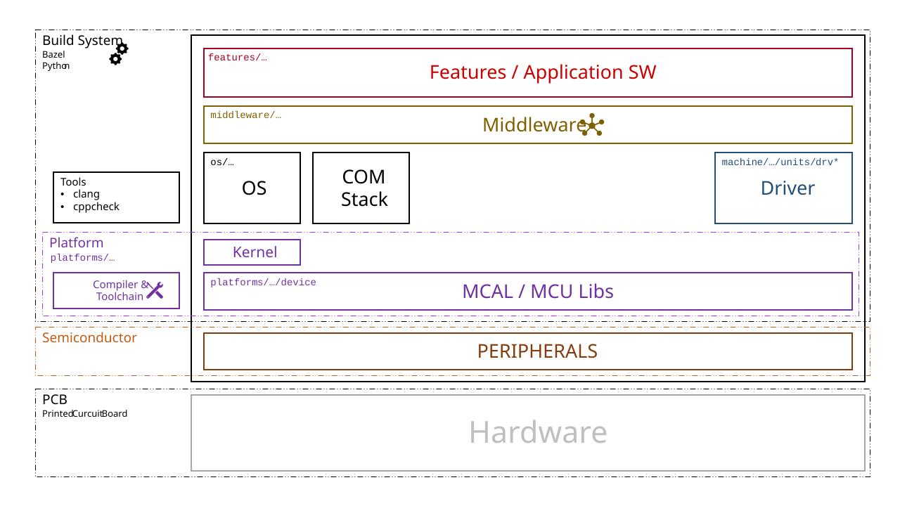

# Embedded Project (retired)

> **This repository is retired.** The software now lives in smaller repositories:
>
> - Generic: [emb-ci](https://github.com/t0biasm/emb-ci) (CI), [emb-toolchain](https://github.com/t0biasm/emb-toolchain) (compilers, toolchains), [emb-platform](https://github.com/t0biasm/emb-platform) (MCU support, FreeRTOS)
> - Projects: [prj-sumobot](https://github.com/t0biasm/prj-sumobot), [prj-tif2838](https://github.com/t0biasm/prj-tif2838)
>
> How the projects are set up and kept generic: [t0biasm](https://github.com/t0biasm).

The rest of this file describes the old monorepo and is kept for reference only.
Repository for embedded software development

## Overview
Repository structure and overview of the software architecture


## Prerequisites
### Tools
Necessary tools
- Bazel version 8.1.1
- python 3.x

Recommended tools
- LLVM (e.g. clang-format, clang-tidy)

## Checks
### Source File Format
Checking Source files `.c/.h` format with clang-format
```
bazel run //tools/llvm:clang_format_check
bazel run //tools/llvm:clang_format_check -- machine/evalBoard/
```

Fixing Source files `.c/.h` format with clang-format
```
bazel run //tools/llvm:clang_format_fix
bazel run //tools/llvm:clang_format_fix -- machine/evalBoard/
```

### Source File Naming Convention

